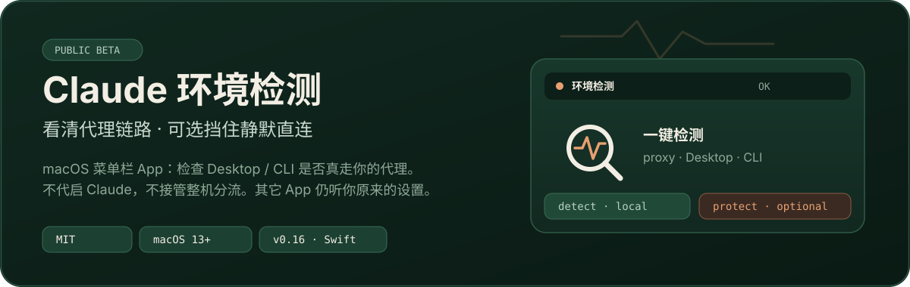
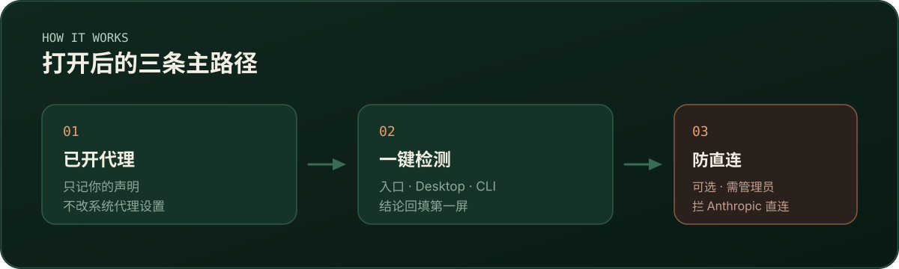

<p align="center">
  
</p>

<p align="center">
  <a href="LICENSE"></a>
  
  
  <a href="https://github.com/crazyooo/claude-launcher/issues"></a>
</p>

macOS 菜单栏应用：检查 Claude Desktop / CLI 是否真走你自己的代理；可选在链式代理异常时，挡住对 Anthropic 的静默直连。

**不代启 Claude，不接管整机分流。** 其它 App 继续听系统 / 你的代理客户端。

由 [crazyooo](https://github.com/crazyooo) 维护 · 标识 `local.crazyooo.*` · 源码 [MIT](LICENSE)

## 它做什么

| 做 | 不做 |
| --- | --- |
| 核对本地代理入口是否在听 | 代你启动 Claude |
| 分别检测 Desktop / CLI / 诊断路径 | 整机 TUN / 域名分流路由器 |
| 可选拦 Anthropic 物理口直连 | 自动停你的代理客户端或其它 App |
| 读取 IPSuper / Net.Coffee 两页可见结果作补充 | 伪造 `protection_verified` / 关闭 TLS 校验 |

完整边界见 [docs/product-detect-guard.md](docs/product-detect-guard.md)。最短上手：[docs/for-others-quickstart.md](docs/for-others-quickstart.md)。

<p align="center">
  
</p>

## 30 秒理解主路径

1. **已开代理** — 本机记忆你的声明，并核对本地入口；不改系统代理  
2. **一键检测** — 后台采样，结论回填第一屏（浏览器页可选）  
3. **防直连（可选）** — 禁止 Anthropic 物理口直连；代理异常时可停 Claude  
4. **其他工具 / 问题与日志** — 外链目录与脱敏诊断  

侧栏只保留上述主路径。遗留 `RoutingCore` 仅为兼容依赖，不在本版本功能验收内。

## 安装（从源码）

需要 **macOS 13+** 与 **Xcode 16.4**（或兼容工具链）。默认装检测版：不写启动包装、不自动改 PF。

```sh
git clone https://github.com/crazyooo/claude-launcher.git
cd claude-launcher
/usr/bin/python3 -I -B tools/fetch_router_core.py
DEVELOPER_DIR=/Applications/Xcode-16.4.app/Contents/Developer bash tools/build.sh
/usr/bin/python3 -I -B tools/install.py install
open ~/Applications/Claude\ Launcher.app
```

应用装在 `~/Applications/Claude Launcher.app`。首次请在检测设置里填入**自己的**固定出口与代理入口；文档里的 `203.0.113.0/24` 只是示例。

若本机曾装旧版隔离组件，可先预览再退役：

```sh
/usr/bin/python3 -I -B tools/retire_legacy.py plan --scope user
# 核对后再执行输出里的 apply_command
```

曾用过旧标识 `local.crazymax.*` 的机器：先迁移/退役，再装新版，不要两套并行。

## 可选：防直连

> **权限警告：** 会安装 root 所有的特权入口（`/Library/PrivilegedHelperTools/local.crazyooo.claude-protect/`），并可能改动 PF。安装前请自行审阅源码与安装器摘要。免密码仅限精确 `status`；开关走 macOS 管理员授权，当前不承诺 Touch ID。单独升级 App **不会**撤销旧 sudoers。

应用内「防直连」页提供检查、开启、关闭与刷新；授权迁移见 [快速开始](docs/for-others-quickstart.md)。只读检查示例：

```sh
/usr/bin/python3 -B tools/claude_protect_pf.py generate
/usr/bin/python3 -B tools/claude_protect_guard.py status
/usr/bin/python3 -B tools/claude_protect_guard.py check --dry-run
```

```sh
sudo -n /Library/PrivilegedHelperTools/local.crazyooo.claude-protect/claude-protect status
```

L3 `apply` / `unload` 与 root hook 须双确认；L4 真杀进程须去掉 `--dry-run`。L2 模板：[docs/claude-protect-l2.md](docs/claude-protect-l2.md)。  
`armed=true` ≠ 防护已验证通过。

## 检测源

仅这两个公开页（不逆向接口，不覆盖本机 Desktop/CLI 结论）：

- [IPSuper Claude](https://ipsuper.com/claude/) — 当前主要是环境风控结果  
- [Net.Coffee Claude](https://ip.net.coffee/claude/) — 出口 / 地区 / 连通性等可见字段  

## 欢迎体验与反馈

如果你也在用 Claude + 自有代理，欢迎从源码构建试用，并开到 [Issues](https://github.com/crazyooo/claude-launcher/issues)：

- 检测结论是否好懂、有没有误导  
- 菜单栏 / 第一屏哪里卡住  
- 可选「防直连」的安装、授权、开关是否符合预期  
- macOS / Xcode 版本，是否装了特权 helper  

请脱敏（不要贴真实出口 IP、账号、代理订阅）。安全问题走 [SECURITY.md](SECURITY.md)。贡献说明：[CONTRIBUTING.md](CONTRIBUTING.md)。

## 开发验证

```sh
DEVELOPER_DIR=/Applications/Xcode-16.4.app/Contents/Developer \
  swift test --disable-sandbox --filter LauncherCoreTests

PYTHONPATH=tools:tools/l4 /usr/bin/python3 -B -m unittest \
  claude_protect_pf_tests claude_protect_guard_tests \
  router_pf_root_hook_tests detector_installer_tests \
  install_guard_daemon_tests install_sudoers_nopasswd_tests
```

默认跳过真实网站读取。设 `CLAUDE_LAUNCHER_LIVE_WEBSITES=1` 并筛选 `WebsiteResultsLiveTests` 可测两站读回。  
**不要无筛选跑全量测试：** 部分 RoutingCore Live 用例会改本机网络 / PF。

验证范围与诚实边界：[docs/detect-acceptance.md](docs/detect-acceptance.md)。曾复跑：LauncherCoreTests 309 通过 / 1 Live 跳过；Python 57/57。

## 许可与尚未完成

- 源码 [MIT](LICENSE) · 第三方说明 [docs/third-party-notices.md](docs/third-party-notices.md)  
- 公开仓**默认不附带** Mihomo 等代理二进制；自行捆绑须满足对应许可证  
- 仍待：真实防直连差分与部分 GUI 验收、检测体验收尾、Developer ID / 公证的官方二进制（当前无安装包 Release）
